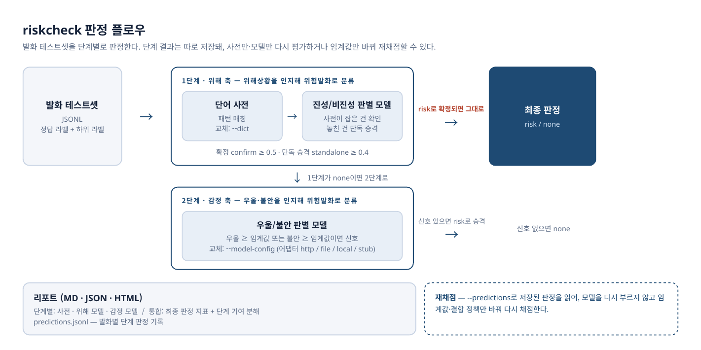
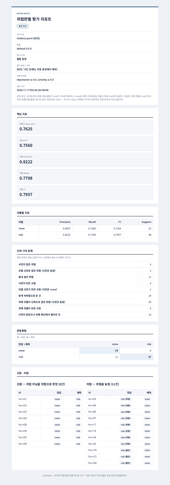

# Safety Ruleset Library

사용자의 발화를 분석해 위험상황을 포착하는 **위험발화 판별 테스트 도구**다. 발화 테스트셋을 단계별로 판정하고, 전체·라벨별 지표를 리포트로 낸다.

판정은 두 축으로 이뤄진다.

- **위해 축**: 단어 사전과 진성/비진성 판별 모델이 사용자의 위해상황(자살·자해)을 인지해 위험발화로 분류한다.
- **감정 축**: 우울/불안 판별 모델이 사용자의 우울·불안을 인지해 위험발화로 분류한다.

- 판정 단계는 분리돼 있다. **단어 사전 단계**와 **분류모델 단계**(어댑터 교체: http/file/local/stub)가 모두 구현돼 있고, 단계별 결과를 따로 저장해 사전만·모델만 재평가하거나 임계값만 바꿔 재채점할 수 있다.
- 사전과 판별 모델은 교체 가능하다. 기본 사전과 기본 모델이 함께 제공되며, 자기 사전·모델로 바꿔 끼울 수 있다.
- 판정은 **위험/비위험 이진**이다: `risk`(위험) / `none`(위험 아님). 사전 패턴에 등급은 없다. 테스트셋 정답이 등급(`danger`/`emergency`)으로 붙어 있어도 채점할 때 `risk`로 접는다 — 단어 사전만으로는 긴급과 위험을 신뢰성 있게 가를 수 없기 때문이다.

> 기본 사전과 기본 모델은 성능 측정의 출발점이다. 실서비스의 안전 판정에 그대로 쓰지 말 것.

## 설치

```bash
pip install -e .
```

의존성은 PyYAML 하나뿐이다. (개발용: `pip install -e ".[dev]"`)

기본 모델까지 함께 쓰려면 로컬 모델 실행용 패키지를 설치하고 모델을 내려받는다.

```bash
pip install -e ".[local-hf]"
python3 tools/download_models.py
```

## 사용법

테스트셋 평가:

```bash
riskcheck evaluate --dataset data/testset.jsonl --dict dicts/default.yaml --out runs/run
```

출력 폴더에 네 파일이 생긴다.

- `predictions.jsonl` — 발화별 판정과 걸린 패턴
- `report_dict.json` — 지표 전체 (기계 판독용). 모델 단계는 `report_model`, 통합은 `report_combined`
- `report_dict.md` — 사람이 읽는 리포트. 리포트 구성은 단계마다 다르다: 사전 단계는 판정 지표 + **패턴 매칭 통계**(패턴별 매칭·오탐 건수), 모델 단계는 **하위 라벨 지표**(우울/불안)가 본체이고 등급 파생 판정은 참고로만, 통합 단계는 최종 판정 지표 + **단계 기여 분해**(사전 포착/모델 포착/미탐/단계별 오탐)
- `report_dict.html` — 같은 내용의 HTML 리포트 (브라우저로 바로 여는 단독 파일)

통합 채점의 정답은 위해 라벨이 risk이거나 하위 라벨(우울/불안) 중 하나라도 양성인 경우를 risk로 본다. 여기서 risk는 단계명이 아니라 보편적인 위험 탐지의 이진 정답이며, 하위 라벨이 없는 건은 위해 라벨만으로 정한다. 단계별 리포트는 각 단계의 판정 대상만으로 채점한다.

발화 하나만 판정:

```bash
riskcheck detect --dict dicts/default.yaml "요즘 진짜 죽고 싶어"
# {"predicted": "risk", "matches": [{"pattern_id": "dg-phrase-01", ...}]}
```

## 동작 방식



사전 단계의 매칭 규칙은 다음과 같다.

1. 공백 정규화 → 듣는 상대에게 하는 말("죽고 싶냐", "자살해라" 등) 제거 — 절 단위 로직이라 사전 파일이 아닌 탐지기 내장 규칙으로 둔다
2. 사전의 제외 패턴(excludes) 적용
3. 구(phrase) 패턴은 공백을 지운 텍스트에서, 정규식(regex) 패턴은 원문에서 매칭
4. 패턴이 하나라도 걸리면 `risk`가 되고, 걸린 패턴 전부를 근거로 남긴다
5. 판정 오류 건은 `predicted: null`로 남기고 지표 분모에서 제외한다

판정 실행과 채점은 분리돼 있다. `predictions.jsonl`이 있으면 사전·모델을 다시 돌리지 않고 채점만 다시 할 수 있다.

## 데이터

- `dicts/default.yaml` — 기본 사전 (version 0.5.0). 패턴 80개로, 기본 패턴과 추가 패턴(`dicts/default_extras.yaml`)으로 구성된다. `tools/build_default_dict.py`로 생성·병합한다.
- `data/testset.jsonl` — 규칙 기대값으로 라벨한 회귀 테스트셋 271건 (danger 105, emergency 19, none 147). `tools/convert_rule_tests.py`로 생성한다.

**테스트셋 라벨 원칙**: 회귀 테스트셋의 라벨은 "사람 기준 진짜 위험 여부"가 아니라 **사전 규칙의 기대값**(판정 함수가 돌려줘야 하는 반환값)이다. 즉 이 테스트셋은 사전 탐지기가 규칙 동작을 재현하는지 보는 회귀 검증용이다. 규칙이 잡지만 실제로는 위험이 아닌 케이스(부정문 "죽고 싶다는 생각은 안 해", 인용, 남의 이야기 등)도 기대값대로 danger로 들어 있다.

### 사람 기준 평가셋

- `data/evalset_human.jsonl` — 사람 기준 평가셋. 회귀 테스트셋 271건을 포함해, 사람 기준("발화자 본인의 위험이 드러나는가", 기준은 `docs/라벨_기준_사람기준.md`)으로 라벨한 **500건** (danger 93, emergency 22, none 385). 층 구성은 위해 문장 115, 우울/불안 감정 문장 138 (우울 73 + 불안 69, 중복 포함), 평온 문장 248이다. 라벨과 별도 축으로 확실성(certainty: certain/ambiguous/needs_context)을 축별(등급/우울/불안)로 기록한다 — ambiguous 11건(등급 10 + 우울 1), 사유 포함.
- 경계 케이스의 라벨은 기준 문서의 경계 규칙(약 복용·의도 표명·간접 질문 등)에 따라 정한다. 등급 운영 정의(지금·오늘+행위=emergency 등)와 "못 가르면 상위 등급" 원칙도 기준 문서에 있다. 단 판정·채점은 위험/비위험 이진이라 등급은 라벨 기록용으로만 남고 지표에는 쓰지 않는다.
- 단일 발화로 못 가르는 1건은 `data/context_needed.jsonl`(맥락 필요 바구니)로 분리해 채점에서 뺐다.
- 표기 변형 12건은 `robustness` 태그로 분리해, `--exclude-tag robustness`로 변형 제외 지표를 따로 잴 수 있다.
- 생성은 `tools/build_human_evalset.py` + `tools/build_sublabels.py`.

기본 사전의 사람 기준 실측 (500건, `examples/sample-report-evalset/`):

| 지표 | 값 |
|---|---|
| 정확도 | 0.9540 |
| 위험 Precision / Recall / F1 | 0.8333 / 1.0000 / 0.9091 |
| certain-only (490건) 정확도 / P / R | 0.9592 / 0.8438 / 1.0000 |
| ambiguous (10건) 방향별 | 정답 7, 누락 0, 과탐 3 |
| 미탐 | 0건 |

단 이 Recall 1.0000은 회귀 검증 수치로 읽어야 한다 — 이 평가셋의 위험 문장은 사전 패턴과 겹치는 문장이 많아, 안 본 표현에 대한 일반화 성능은 아래 홀드아웃으로 따로 잰다.

오탐이 전부 "규칙만으로는 못 가르는 맥락 케이스"에 몰려 있는 것이, 사전 단계 뒤에 분류모델 단계가 필요한 근거다.

## 실행 예시 결과

평가를 돌리면 단계별 HTML 리포트가 함께 생성된다 (`examples/sample-report-evalset/`에 기본 사전 + 스텁 어댑터로 사람 기준 평가셋을 평가한 예시가 있다).



기본 구성 전체(기본 사전 + 진성/비진성 판별 모델 + 우울/불안 판별 모델)로 홀드아웃 80건을 평가한 통합 리포트다. 단계 기여 분해에서 위해 모델이 단독으로 잡은 위험과, 사전이 잡았으나 위해 확인에서 떨어진 건이 따로 센 것을 볼 수 있다.

기본 사전 × 회귀 테스트셋 271건 (규칙 동작 재현 여부):

| 라벨 | Precision | Recall | F1 | Support |
|---|---|---|---|---|
| none | 1.0000 | 1.0000 | 1.0000 | 147 |
| risk | 1.0000 | 1.0000 | 1.0000 | 124 |

accuracy 1.0000 — 271건 전부 규칙 기대값과 같은 판정. 자세한 리포트는 `examples/sample-report-regression/`에 있다.

작은 예시 셋(12건, 사전 발췌본)으로는 accuracy 0.8333, macro F1 0.8286이 나온다 (`examples/sample-report/`). 여기에는 사전 단계의 전형적인 실패인 부정문 오탐과 변형 표현 미탐이 각 1건씩 들어 있다.

## 구조

```
src/riskcheck/   # dictionary(로딩·검증), detector(사전 단계), evaluate(실행·채점), report, cli
schemas/         # 데이터 계약 4종 (JSON Schema): 테스트셋, 사전, predictions, 리포트
dicts/           # 기본 사전
data/            # 테스트셋
examples/        # 예시 데이터·사전·샘플 리포트
tools/           # 사전 생성, 테스트셋 변환, 스키마 예시 검증
tests/           # pytest
docs/            # 문서
```

스키마 상세는 `docs/스키마.md`, 형식 검증은 `python3 tools/validate_examples.py`로 한다.

## 테스트

```bash
python -m pytest
```

## 모델 단계

분류모델은 어댑터로 연결한다 (`docs/모델_단계.md`). 어댑터는 `{depression, anxiety, else}` 점수만 돌려주고, 판정은 채점 단계의 임계값 정책이 한다.

기본 모델 두 개(우울/불안 판별 모델, 진성/비진성 판별 모델)가 함께 제공된다. `tools/download_models.py`로 내려받아 두면 설정을 지정하지 않아도 자동 적용된다. 두 모델의 구조·학습 데이터·평가 결과는 [기본 모델 기술 문서](docs/model-documentation.pdf)에 기술되어 있다.

```bash
# 모델까지 실행해 단계별 + 통합 리포트 생성 (models/stub.yaml은 데모용 스텁)
riskcheck evaluate --dataset data/evalset_human.jsonl --dict dicts/default.yaml \
    --model-config models/stub.yaml --out runs/run

# 저장된 결과로 임계값만 바꿔 재채점 (모델 재호출 없음)
riskcheck evaluate --dataset data/evalset_human.jsonl \
    --predictions runs/run/predictions.jsonl --threshold-anxiety 0.3 --out runs/run-rescore
```

어댑터는 `http`(별도 서버로 띄운 모델), `file`(미리 계산한 점수 파일), `local`(로컬 모델 직접 실행), `stub`(데모용 규칙 스텁, 실제 모델 아님) 네 종류다. 통합 규칙은 사전 판정 우선 + 모델 신호로 risk까지 승격이며, 모델 오류는 지표 분모에서 제외한다.

위해(자살·자해 진성) 확률을 내는 모델은 두 번째 슬롯에 연결한다 (`--harm-model-config`). 기본 진성/비진성 판별 모델이 함께 제공되며, 설정을 지정하지 않으면 자동 적용된다. 사전이 잡은 건은 위해 확률이 `confirm`(기본 0.5) 이상일 때 확정하고, 사전이 놓친 건은 위해 확률이 `standalone`(기본 0.4) 이상이면 올리는 결합 정책으로 통합한다.

주의: 정답(자살·자해 위험)과 모델이 재는 것(우울·불안 신호)은 다른 구성개념이라, 모델 단계는 이진 판정 지표가 아니라 하위 라벨 지표로 평가한다.

### 하위 라벨 평가 (사람 기준 평가셋)

- 사람 기준 평가셋에 하위 라벨(우울/불안)이 전건 들어 있다. 우울 양성 73 (판정 보류 null 34), 불안 양성 69 (null 1). 기준은 `docs/하위라벨_기준.md`, 보류 목록은 `docs/하위라벨_경계목록.md`. 하위 라벨은 감정 상태만 재는 축이라 자살·자해 진술은 그 자체로 우울 양성의 근거가 되지 않고, 피로·번아웃은 우울 false, 환청 진술은 불안 null이다. 리포트에 null 제외 건수와 certain-only 지표가 병기된다.
- 모델 리포트에 하위 라벨 지표(클래스별 Precision/Recall/F1 + 합산)가 함께 나온다. 스텁 데모 실측: 우울 P 0.61 / R 0.19, 불안 P 0.85 / R 0.41 — 우울은 어휘 의존 스텁의 한계가 그대로 드러난다 (`examples/sample-report-evalset/`).

### 대표 평가셋 (위해 비율 30% 균형셋)

- `data/evalset_balanced30.jsonl` — 위해 비율 30% 균형 평가셋 **500건**. 카테고리별 층화 구성이다: 위해 150건(직접 진술·임박 계획·완곡 표현·행위 언급·고백), 비위해 350건(일상·인용/타인 얘기·과장/관용·과거 해소·조건 가정). 하위 라벨(우울/불안)이 함께 들어 있어, 통합 채점(정답 = 위해 라벨이 risk이거나 하위 라벨 중 하나라도 양성)의 대표 측정에는 이 셋을 쓴다.
- 기본 사전 + 스텁 어댑터 실측 (`examples/sample-report-balanced30/`): 사전 단독 정확도 0.6520, 위험 Precision 0.4504 / Recall 0.7267 / F1 0.5561. 통합(사전+스텁) 정확도 0.6100, Precision 0.4809 / Recall 0.6811 / F1 0.5638.
- 기본 모델 전체 구성(기본 사전 + 진성/비진성 판별 모델 + 우울/불안 판별 모델) 실측: 정확도 0.8560, 위험 Precision 0.7839 / Recall 0.8432 / F1 0.8125.
- Precision은 셋의 위해 비율에 따라 달라진다. 비율이 다른 셋의 수치와 비교할 때는 비율을 함께 본다.

### 홀드아웃 평가 (일반화 성능)

- `data/holdout.jsonl` — 사전 제작에 쓰인 적 없는 신규 문장 80건 (위해 40 + 비위해 40, `tools/build_holdout.py`). 위해 쪽은 완곡·은유 표현 위주로 구성한 스트레스 테스트 성격의 셋이다. 평가셋 본체와 합치지 않는다 — 합치는 순간 홀드아웃이 아니게 되며, 이 셋을 보고 사전을 고치지도 않는다 (측정 전용).
- 기본 사전 실측: 정확도 0.4375, 위험 Precision 0.2727 / Recall 0.0750. 완곡 표현("세상을 뜨고 싶어", "긴 잠에 빠지고 싶어", "내 존재를 지워버리고 싶어")은 단어 매칭으로 닿지 않는 영역이며, 비위해 오탐 8건은 인용·타인 얘기·메타 발언에 위해 어휘가 그대로 있는 경우다. 사전 단계의 커버리지는 직접 표현에 한정되고, 완곡·맥락 영역은 분류모델 단계와 맥락 판정이 필요한 이유가 이 수치에 드러난다.

## 후속 계획

- 실제 분류모델 연결 (기본 모델 KoELECTRA-small 제공, 어댑터로 다른 모델로 교체 가능) — 임계값은 하위 라벨 지표로 결정
- 사전 확장: 평가셋을 늘리면서 완곡·변형 표현을 오탐 비용을 재며 추가
- 맥락 포함 판정 트랙: `context_needed` 항목처럼 직전 대화가 필요한 케이스를 다루는 별도 평가 축

## 프로젝트

이 소프트웨어는 "국민 정서 안전망 구축을 위한 정서 고립 선제 감지 및 적시 개입 에이전틱 AI 기술개발" 프로젝트를 위해 만들어졌습니다.
